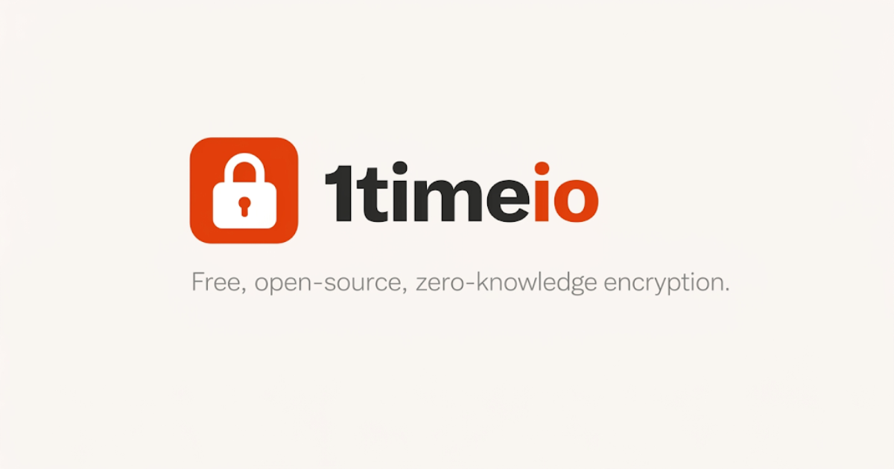
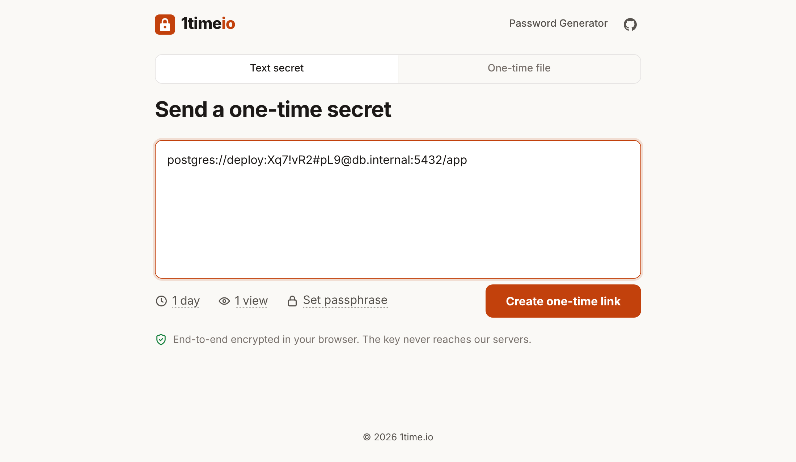
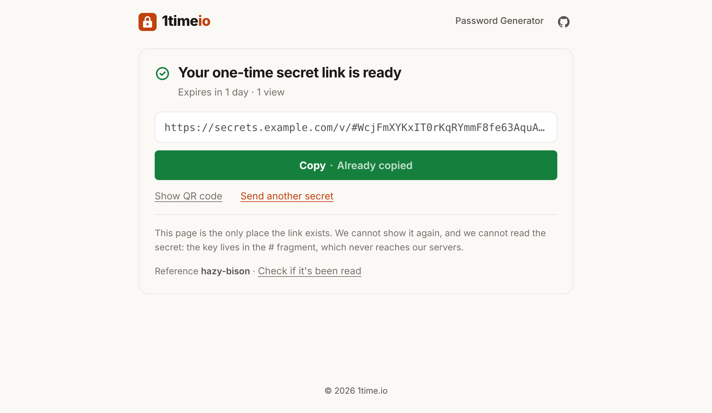
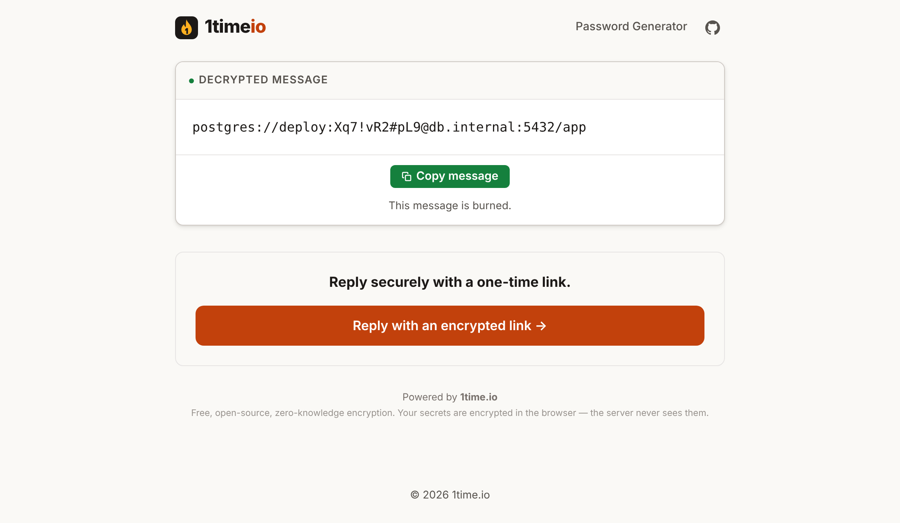
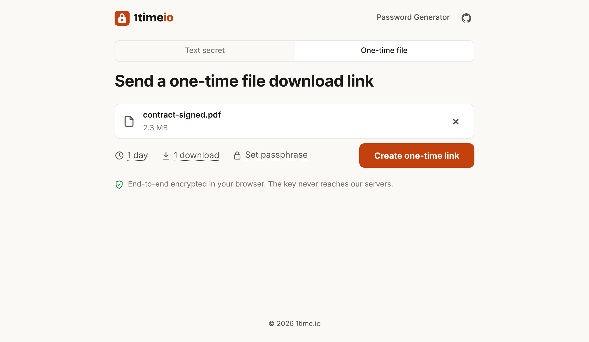

<p align="center">
  <a href="https://1time.io">
    
  </a>
</p>

<p align="center">
  <strong>One-time links for passwords, API keys and files.</strong><br>
  Encrypted in your browser, opened once, then deleted. Use <a href="https://1time.io">1time.io</a> or run your own.
</p>

<p align="center">
  <a href="https://1time.io"></a>
  &nbsp;
  <a href="#self-hosting"></a>
</p>

<p align="center">
  <a href="LICENSE"></a>
  <a href="https://github.com/shingrus/1time.io/releases"></a>
  <a href="https://www.npmjs.com/package/@1time/cli"></a>
</p>

<p align="center">
  
  &nbsp;&nbsp;
  
</p>
<p align="center">
  
  &nbsp;&nbsp;
  
</p>

## What it does

You paste a secret, or pick a file, and get a link. The recipient opens it once and it's deleted. You can allow up to 10 views if a few people need it, and every link expires on its own after anywhere from an hour to 30 days, opened or not. Files can be up to 250 MB, and you can add a passphrase for links that shouldn't open on their own.

The encryption happens in the browser before anything is uploaded, so the server only ever holds ciphertext. There are no accounts. A CLI and a browser extension speak the same protocol, and both work with 1time.io or your own instance. The whole thing is Go, Redis and static HTML, MIT licensed.

## How it works

```
Sender's browser                Server                     Recipient's browser
  encrypt with a random key ──► stores ciphertext only
  link = …/v/#<key>                (can't decrypt)
          └────────── share the link ───────────────────────► opens the link
                                 ◄── proves it holds the link
                                 sends ciphertext, deletes it ─► decrypts with #<key>
```

The key is in the part of the link after the `#`, which browsers never send to the server. From that key the browser derives two things with HKDF-SHA256: an AES-256-GCM key and a read token. The sender uploads only a SHA-256 hash of the token. When the recipient opens the link, their browser sends the token, the server checks it against the hash, hands over the ciphertext and deletes it. That means the server, whoever runs it and its database can't read a secret. A database dump can't be used to open one or burn one either.

Files go through the same steps. The browser encrypts the file together with its name and type, then uploads it in 4 MiB pieces, so if the connection drops you only resend one piece. The full protocol, the HTTP API and test vectors are on the [developers page](https://1time.io/developers/).

## Self-hosting

You can run your own instance for your team, on your own domain. The self-hosted build is only the tool itself, meaning text and file sharing, the password generator and My Secrets. There's no blog, no marketing pages and no analytics, and it doesn't load anything from other hosts. Links are built from whatever address people open it at, so there's no hostname to set.

```bash
curl -O https://raw.githubusercontent.com/shingrus/1time.io/master/docker-compose.yml
curl -O https://raw.githubusercontent.com/shingrus/1time.io/master/.env.example
cp .env.example .env
docker compose up -d
```

That gives you three containers on `http://localhost:8080`: Redis, the Go API, and nginx serving the frontend. Data goes under `DATA_DIR`, and the images are built for amd64 and arm64. If you'd rather build from source:

```bash
git clone https://github.com/shingrus/1time.io.git && cd 1time.io
cp .env.example .env
docker compose -f docker-compose.dev.yml up -d --build
```

### HTTPS

Put whatever reverse proxy you already use in front. With Caddy on the same host, this is all it takes:

```
secrets.example.com {
    reverse_proxy localhost:8080
}
```

The container already sends a CSP, `X-Frame-Options` and a strict `Referrer-Policy`, and the secret and file pages send no referrer at all. It leaves HSTS out on purpose, so set that on your proxy.

### Configuration

Everything goes in `.env`. Change it and restart, there's nothing to rebuild.

| Variable | Default | |
|---|---|---|
| `APP_PORT` | `8080` | Port on the host |
| `DATA_DIR` | `./data` | Redis data and encrypted files |
| `TRUSTED_PROXIES` | the container's Docker network | Proxy addresses or CIDRs whose forwarded visitor IP is believed; `none` trusts nobody |
| `REAL_IP_HEADER` | `X-Forwarded-For` | `CF-Connecting-IP` behind Cloudflare |
| `RATE_LIMIT` | `on` | `off` disables API rate limits |
| `RATE_LIMIT_WRITE` / `_UPLOAD` / `_READ` | `45r/m` / `120r/m` / `60r/m` | Per visitor: secrets created / file chunks (a 250 MB file is 63) / secrets and files opened |
| `BACKEND_UPSTREAM` | `backend:8080` | Where nginx sends `/api/` |

### Rate limits behind a proxy

Limits apply per visitor, which only works if nginx knows the real visitor address. By default it takes that address from a proxy only when the proxy is on the container's own Docker network. A proxy container in the same compose file counts, and so does a proxy on the host. If your proxy runs on another machine, add its address to `TRUSTED_PROXIES`. Until you do, everyone shares the proxy's limit.

Please don't trust a whole private range like `10.0.0.0/8`. On an internal network your users have private addresses too, and any of them could then fake an IP to get around the limits. One more case to watch is rootless Docker or Docker Desktop, where nginx may see every client as the Docker gateway. If an instance like that is reachable without a proxy, set `TRUSTED_PROXIES` to your proxy's address and nothing else.

### Upgrading

`APP_HOSTNAME` and `SHOW_BLOG` aren't used anymore. You can delete them from an old `.env`.

### Compared with other self-hosted tools

| | 1time | OneTimeSecret | Yopass | PrivateBin | Password Pusher |
|---|:---:|:---:|:---:|:---:|:---:|
| Zero-knowledge (E2E encrypted) | Yes | No | Yes | Yes | No |
| Self-destructs after first read | Yes | Yes | Yes | Optional | Optional |
| Self-hosted with Docker Compose | Yes | Yes | Yes | Yes | Yes |
| First-party CLI | Yes | No | Yes | No | Yes |
| Built-in password generator | Yes | No | No | No | No |
| Stack | Go + static HTML | Ruby | Go | PHP | Ruby |
| License | MIT | MIT | Apache-2.0 | zlib | Apache-2.0 |

If you're evaluating it for a team, [1time.io/self-hosted](https://1time.io/self-hosted/) goes into more detail.

## CLI

```bash
npm install -g @1time/cli

printf '%s' "$DB_PASSWORD" | 1time send          # → https://1time.io/v/#…
1time read 'https://1time.io/v/#…'
1time send-file ./backup-codes.txt
1time read-file 'https://1time.io/f/#…'

printf '%s' "$TOKEN" | 1time send --host https://secrets.example.com   # your instance
```

It encrypts locally, so the plaintext never leaves your machine. You need Node.js 20 or newer. The [CLI docs](cli/README.md) have the rest.

## Build your own client

Everything you need to write your own is on the [developers page](https://1time.io/developers/), including the protocol, the HTTP API, limits and test vectors. It's written so you can paste it into a coding agent as is, and there's a [plain text](https://1time.io/developers/agent-spec.txt) version.

## Development

You'll need Go 1.25+, Redis 7+ and Node.js 22.23+.

```bash
# Backend on http://127.0.0.1:8080 (expects Redis on 127.0.0.1:6379)
mkdir -p /tmp/1time-files
FILE_STORAGE_DIR=/tmp/1time-files REDISHOST=127.0.0.1:6379 REDISPASS= go run ./backend

# Frontend on http://127.0.0.1:3001, proxying /api to the backend
cd frontend && npm install && npm run dev
```

The frontend comes in two versions. `npm run build` gives you the full 1time.io site, and `SELF_HOSTED=true npm run build` gives you the self-hosted tool, which is what Docker builds by default. Each build finishes by checking links, and it fails if a page points somewhere that version doesn't have.

To run the tests, use `go test ./backend/...`, `cd frontend && npm run check` and `cd cli && npm test`. `make build` produces `bin/1time-api` and `frontend/build/`. The architecture and conventions are in [AGENTS.md](AGENTS.md), and [docs/vm-deployment.md](docs/vm-deployment.md) explains how 1time.io itself is deployed without Docker.

## Browser extension

Select some text on a page, right-click, or press `Alt+Shift+S`, and a one-time link for it lands on your clipboard. It works in Chrome, Edge, Brave and the other Chromium browsers. By default it uses 1time.io, and you can point it at your own instance in its options. You can [add it to Chrome](https://chromewebstore.google.com/detail/1time-%E2%80%94-one-time-secret-l/oclenaeccacnolionlpiefekmmbppgkb), and the source is in [`extension/`](extension/).

## Contributing

Pull requests are welcome. For anything bigger than a small fix, please open an issue first so we can talk it through. [CONTRIBUTING.md](CONTRIBUTING.md) has the setup.

If you find a security problem, please don't open a public issue. [SECURITY.md](SECURITY.md) explains how to report it privately.

## License

[MIT](LICENSE). Copyright (c) 2018-2026 1time.io
